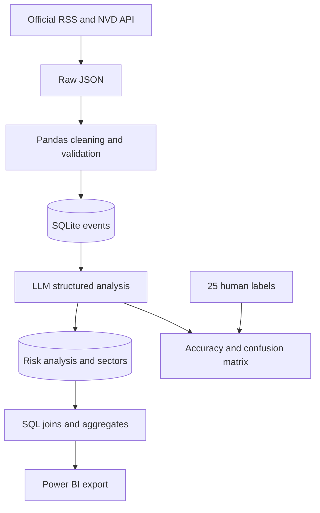

# AI-Powered Enterprise Risk & Market Intelligence Platform

A reproducible Python, SQL, and AI pipeline that converts financial,
regulatory, macroeconomic, and technology events into structured risk
intelligence for analyst review.

> **Project status:** the data, cleaning, SQLite, scoring, baseline,
> evaluation, and dashboard-export layers are functional. LLM results and the
> final Power BI file are produced only when the required user-owned API key
> and Power BI Desktop are available. The rule-based baseline is clearly
> separated from LLM output and is never presented as AI accuracy.

## Business problem

Risk analysts receive more information than they can read in depth each day.
The platform answers five triage questions:

1. What happened?
2. What is the primary risk category?
3. Which sectors may be affected?
4. How urgently should an analyst review it?
5. What transmission channel or follow-up indicator matters?

The system is a decision-support and prioritization tool. It does not predict
prices, estimate losses, or make automated trading decisions.

## Architecture



## Current data

The committed sample was collected from public, official sources:

- Federal Reserve press-release RSS
- U.S. Securities and Exchange Commission press-release RSS
- Office of the Comptroller of the Currency RSS
- NIST National Vulnerability Database API

The latest verified run produced **79 cleaned events from four sources**, with
no missing dates, no missing headlines, and no duplicate event IDs. An
optional Alpha Vantage connector is included for broader market-news coverage;
it is disabled unless the user supplies an API key.

## Risk taxonomy

| Category | Primary transmission channel |
|---|---|
| Market Risk | Rates, FX, equities, commodities, volatility, or liquidity |
| Credit Risk | Default, repayment capacity, counterparty weakness, or asset quality |
| Operational Risk | People, processes, vendors, fraud, legal/compliance, or continuity |
| Technology Risk | Cybersecurity, data, software, AI/models, or infrastructure |
| Emerging Risk | New or difficult-to-quantify geopolitical, climate, public-health, or regulatory exposure |

Each event receives one primary category for evaluation, but can connect to
one to three sectors through a many-to-many database relationship.

## Explainable risk score

The score measures analyst priority, not a probability of loss:

```text
Risk Score = 20 × (0.5 × Severity + 0.3 × Breadth + 0.2 × Urgency)
```

All components are integers from 1 to 5, producing a score from 20 to 100.
Severity has the largest weight because consequence matters most; breadth
captures propagation; urgency captures response speed. Model confidence is
stored separately because uncertainty and impact are different concepts.

## Database design

- `events`: cleaned source events
- `risk_analysis`: category, score components, summary, and analyst focus
- `sectors`: controlled sector lookup
- `event_sectors`: many-to-many junction table
- `dashboard_events`: SQL view joining the analysis layer for reporting

See [`sql/schema.sql`](sql/schema.sql) and
[`sql/analysis_queries.sql`](sql/analysis_queries.sql). The examples exercise
`SELECT`, `WHERE`, `GROUP BY`, `JOIN`, `ORDER BY`, `COUNT`, and `AVG`.

## Reproduce the sample run

```bash
python -m venv .venv

# Windows PowerShell
.venv\Scripts\Activate.ps1

pip install -r requirements.txt
pip install -e .
python -m risk_intel.pipeline --raw-path data/raw/sample_events.json --method baseline
python scripts/run_sql_examples.py
python scripts/evaluate_model.py
pytest -q
```

The baseline is intentionally simple and transparent. On the balanced 25-event
human-labelled set it achieved **32.0% accuracy**. This is a real benchmark,
not the final LLM result. It demonstrates why keyword matching is insufficient,
particularly when regulatory technology and digital assets overlap with
emerging or operational risk.

## Run the LLM pipeline

Copy `.env.example` to `.env` and enter a user-owned API key. First test three
events, then evaluate only the 25 human-labelled events:

```bash
python -m risk_intel.pipeline --raw-path data/raw/sample_events.json --method llm --limit 3
python scripts/run_labelled_evaluation.py
```

After reviewing the real evaluation result, create the full dashboard dataset:

```bash
python -m risk_intel.pipeline --raw-path data/raw/sample_events.json --method llm
```

Completed LLM results are written incrementally to
`data/processed/llm_analysis_cache.jsonl`. If a request fails, rerun the same
command: completed event IDs are reused instead of generating and paying for
them again. The full run also reuses the 25 evaluation results.

The prompt defines the risk taxonomy, permitted sectors, rating scales, and a
strict JSON schema. The model returns category, sectors, score components,
summary, and analyst focus in machine-readable form. The Python layer validates
the structure and computes the score itself so the formula is reproducible.

Never commit `.env` or an API key.

## Power BI

The SQL view is exported to `data/processed/dashboard_events.csv`. The proposed
one-page dashboard answers five business questions:

- Which events require review first?
- Where is risk concentrated by category?
- Is average risk intensity changing over time?
- Which sectors appear most exposed?
- Is the event set dominated by low- or high-severity items?

Build instructions and DAX measures are in
[`powerbi/dashboard_spec.md`](powerbi/dashboard_spec.md). The final repository
should include the `.pbix` file and a screenshot after opening the export in
Power BI Desktop.

## Project structure

```text
data/            raw sample, cleaned outputs, and human labels
database/        generated SQLite database
docs/            data dictionary and interview material
powerbi/         dashboard build specification and final PBIX
reports/         evaluation metrics and confusion matrix
scripts/         evaluation and SQL demonstration scripts
sql/             schema, view, and analysis queries
src/risk_intel/  collection, cleaning, analysis, scoring, and database code
tests/           unit tests for cleaning and scoring
```

## Limitations

- The sample is a recent event window, not a representative history of all risks.
- The 25-event evaluation set is deliberately small and balanced.
- Category boundaries can be ambiguous; results support, not replace, human review.
- Scores are ordinal prioritization aids, not calibrated expected-loss estimates.
- RSS availability and source coverage can change over time.

## Responsible use

The repository stores short official-source descriptions and links rather than
full commercial news articles. API keys remain local. The pipeline records the
analysis method and timestamp so baseline and LLM results cannot be confused.
